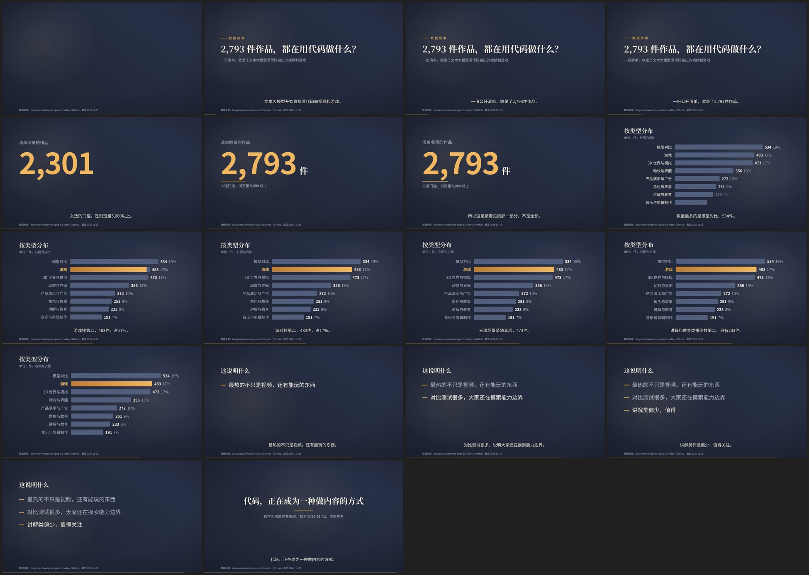

# DreamFactory

用代码做视频的管线，以及验证它的评测集。第一条垂直管线是**数据故事短片**：给一份简报和一份数据，产出一支带旁白、字幕和图表的讲解视频，并自动检查它对不对。

为什么做这个、为什么先做评测，见[调研报告](docs/llm-video-game-research.md)。



## 现状

- 一条管线端到端跑通：脚本、时间轴、渲染、自检、成片。
- 16 项自检，其中 15 项在运行，1 项（语音识别核对）还没接入。
- 评测集：7 个用例，25 条注入缺陷。[最近一次结果](evals/BASELINE.md)是干净用例误报 0/7，缺陷检出 25/25。
- 一支片子可以自带场景代码：内置场景做不出的画面（比如折线图），由智能体为这支片子现写，同样要过自检。
- 无人值守：模型只拿简报和数据，3 个用例都独立交付了通过复验的影片，每支约 1 美元、两分钟。[运行记录](evals/agent-runs/2026-11-14-claude-fable-5-2/SUMMARY.md)。

## 运行

需要 Node 20 以上、ffmpeg、一种中文字体。语音默认用离线的 espeak-ng，没装时退回静音轨并按字数估算时长。

```bash
npm install
```

```bash
npx playwright install chromium
```

做一支片子：

```bash
node pipeline/cli.mjs run evals/cases/works-by-category --draft
```

成片在影片目录的 `out/film.mp4`，自检报告在 `out/report.md`，抽帧图在 `out/contact.jpg`。去掉 `--draft` 得到 1080p、30 帧的成片；加 `--no-video` 只做文字层检查，十几秒完成。

跑评测集，约两分钟：

```bash
node evals/run.mjs
```

## 管线怎么工作

一支片子是一个目录，里面有三个文件：

| 文件 | 谁写 | 内容 |
| --- | --- | --- |
| `data.json` | 任务给定 | 事实来源：数字、数据来源、截止日期 |
| `expect.json` | 任务给定 | 要求：片长范围、必须出现和必须念到的数据 |
| `film.json` | 智能体 | 分镜和旁白，数字一律引用 `data.json` |

运行时依次做五件事：

1. **解析引用**：把 `film.json` 里指向数据的地方填上真实数字。
2. **定时间轴**：先合成每句旁白，量出时长，再据此排出每个场景和每句字幕的起止时间。
3. **读画面**：在无头浏览器里按时间轴逐点走一遍，直接从页面读出每个时刻屏幕上有哪些文字、在哪里、什么颜色。
4. **渲染**：逐帧截图交给 ffmpeg 编码，混入旁白。
5. **自检**：对画面文字、成片和音轨跑检查，写出报告。

画面完全由时间决定：给定任意时刻就能画出那一帧，所以结果可重复，检查读到的就是观众看到的。

写 `film.json` 的规则和字段见 [DIRECTOR.md](DIRECTOR.md)。

## 自检项

| 检查 | 查什么 |
| --- | --- |
| `data-accuracy` | 画面和旁白里的每个数字都能在数据里找到；要求出现的数据确实出现了 |
| `citation` | 用到数据的画面都标了来源 |
| `readability` | 每段文字停留的时间够读完，字号够大 |
| `layout` | 文字不出画面、不溢出容器、不互相重叠 |
| `contrast` | 文字与背景的对比度达标 |
| `subtitles` | 字幕与旁白逐句对应，单句不过长 |
| `typography` | 没有重复的标点、残留的模板符号、空括号 |
| `empty-frames` | 没有超过 1.5 秒的空画面 |
| `marks` | 标了数值的图形，长短高低与数值一致；自带的图表必须标数值 |
| `determinism` | 同一时刻重画，画面一致，没有用随机数、时钟或上一帧的状态 |
| `fonts` | 中文没有显示成方框 |
| `spec` | 片长、分辨率、帧率、编码、音画等长 |
| `video-stillness` | 没有黑屏，画面静止不超过 6 秒 |
| `audio-levels` | 响度在 -14 LUFS 上下，峰值不过载 |
| `audio-gaps` | 旁白之间没有过长的无声 |
| `asr` | 语音识别结果与旁白稿一致（未接入，报告里显示为跳过） |

## 评测集

评测集回答两个问题。

**检查会不会冤枉好片子？** `evals/cases/` 下每个用例有一支参考影片，它们不应该触发任何检查。触发了就是误报。

**检查抓不抓得到它声称能抓的问题？** `evals/defects.json` 里每条缺陷只在参考影片上改一处，比如把 483 抄成 583，并写明哪项检查必须失败。没失败就是漏检。

当前用例：

| 用例 | 考什么 |
| --- | --- |
| `works-by-category` | 柱状图、大数字、占比 |
| `cost-per-minute` | 跨四个数量级的区间，对数刻度 |
| `works-by-category-en` | 同一份数据换成英文，管线不改 |
| `monthly-trend` | 要求折线图，内置场景做不出来，必须自己写场景代码 |
| `top-of-long-list` | 24 个乱序品类里选出前 6 名，全放会撑破画面 |
| `twenty-seconds` | 22 秒内讲完三件事，还要留够阅读时间 |
| `asks-for-derived-number` | 简报要一个数据里没有的数字，考的是不编数字、不改数据、如实说明 |

后四个用例用的是虚构的示例数据，数据来源里写明了这一点。

换模型、换语音或视频供应商、改管线之后重跑评测，就能知道有没有变坏。

### 无人值守运行

上面两问考的是检查本身。第三问考的是模型加上导演规范，能不能在没有人的情况下独立交付：

```bash
node evals/agent-run.mjs
```

脚本给每个用例建一个干净的工作区，里面只有管线、`DIRECTOR.md` 和任务的简报、数据、要求，没有参考影片。模型只能写任务目录、只能运行管线命令，其余操作会被自动拒绝。模型交付后，脚本用用例原本的数据和要求再复验一遍，并记录管线运行次数、费用和是否守规。

需要已登录的 Claude Code 命令行，会产生模型费用，每个用例默认上限 8 美元。结果写到 `evals/agent-runs/`。

第一次运行的结果是 3/3 通过，没有一次检查失败。这同时说明现有用例太容易，分不出模型之间的差别。模型的汇报还指出了管线自己的四个缺口，已经修掉，其中“占比显示成 17%%”补成了一项新检查和两条缺陷样例。

## 已知局限

- **语音是机器味很重的 espeak-ng。** 它只用来证明流程能跑通。`edge` 后端已经写好，但在开发环境里连不上服务，没有实际跑过。
- **没有背景音乐和音效。**
- **缺陷是和检查一起写的。** 16/16 说明检查能抓到设计时想到的问题，不代表能抓到没想到的问题。第一次无人值守运行就遇到了一个当时没有检查能抓到的问题。
- **三项检查没有缺陷样例**：`fonts`、`audio-levels`、`asr`，效果未经验证。
- **检查不懂好不好看。** 构图、节奏、是否有吸引力，仍要靠人或智能体看抽帧图。
- **中文数字不核对。** “两千七百”这样的写法会被放过，规范里要求数字写阿拉伯数字。
- **用例太容易，而且是照着现有场景出的题。** 无人值守运行里没有出现过检查失败，所以它还测不出返工能力。需要现有六种场景表达不了的任务，才知道规范和检查够不够用。
- **费用口径有限。** 每支约 1 美元含命令行的固定开销，不含搭管线和写参考影片的投入，也只跑过一个模型。
- **不支持派生数字。** 增幅、倍数这类要算出来的数字还不能引用，规范要求遇到时如实说明，不要自己算。
- **浏览器重画不是逐位一致的。** 同一时刻重画，偶尔有几十个像素的抗锯齿差异，可重复检查容忍万分之一以内的像素差。
- **只有一种片型，六种内置场景。**

## 目录

```
pipeline/            管线本体：film.mjs 是全流程，lib/ 是各环节，checks/ 是自检
verticals/data-story 数据短片的画面
evals/               用例、缺陷注入集、评测脚本、基线结果
docs/                调研报告
DIRECTOR.md          写给做片子的智能体的规范
CLAUDE.md            写给改这个仓库的智能体的约定
```
