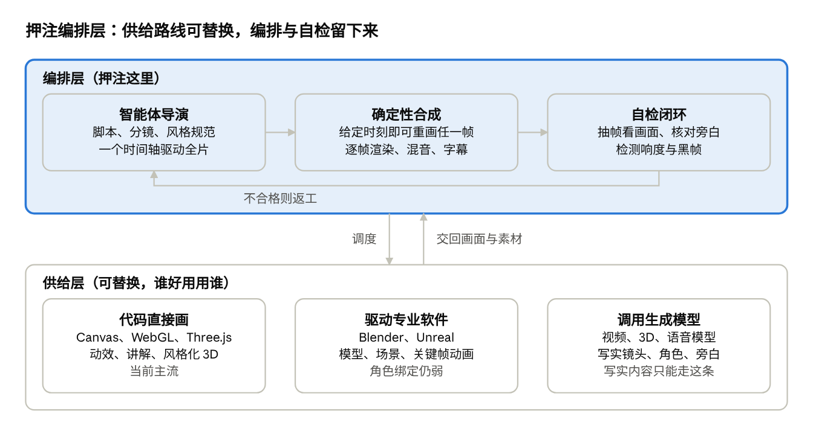

# 文本大模型做视频与游戏：调研与押注判断

2026-11-13

“写代码生成视频和游戏”是真实的技术转向，但它重塑的是能被程序化描述的内容，不是整个影视和游戏工业。建议押注混合管线里的编排层：智能体当导演，代码做骨架，生成模型供素材，自检闭环把关。

## 押注判断

押编排层，不押任何一种渲染技术。渲染手段会随模型换代更替，把它们组织起来并验证结果的那一层会留下来。

| 方向 | 仓位 | 理由 |
| --- | --- | --- |
| 混合管线的编排层：导演规范、确定性时间轴、自检闭环 | 重仓 | 质量随编程模型升级自动上涨；视频和 3D 模型越强，可调度的素材越好，这一层都受益 |
| 信息密集、要反复修改和批量出版本的内容：讲解、产品演示、数据故事、多语言版本 | 重仓 | 相对人工，成本降了两到三个数量级；文字和数据准确、可重渲染，是像素模型难以夺回的结构性优势 |
| 小体量网页游戏与原型，以及能被智能体驱动的引擎工具链 | 中仓 | 220KB 的游戏已能直接在线分发，引擎开始为智能体适配；但验证“好不好玩”比验证一段视频难得多 |
| 以 Blender 等专业软件为主线的全自动制作 | 轻仓 | 适合当素材车间，不适合当主线：角色绑定和角色动画仍弱，单镜头成本高 |
| “一句话出片”的薄封装工具，以及靠产量取胜的内容 | 回避 | 开源方案已有 15.6k star，工具层没有护城河；Steam 已出现供给过剩 |

落地方式：选一个垂直场景，搭一条“脚本、时间轴、渲染、自检、成片”的管线，把生成模型当作可替换的供应商。用三个数衡量：每分钟成片成本、返工轮数、人工介入次数。

## 为什么押这一层

上层三个环节决定成片质量，而且不依赖下层走哪条路线。下层三条路线各有适用范围，会随模型换代此消彼长：目前“代码直接画”是主流，写实内容只能靠生成模型。

## 证据

现象是真的，规模已经不小：

- [lemo-opuscar](https://github.com/lemomo-ai/lemo-opuscar)：15.6k star，99 种影片风格，不用视频模型和素材库，一支片子智能体跑 30–60 分钟。
- [awesome-opus-5.5-video](https://github.com/zhuyansen/awesome-opus-5.5-video)：浏览量 5,000 以上的作品 2,793 件，其中游戏 483、3D 场景 473、动效 356、产品片 272、讲解 233。
- [AI Will 的 X 帖](https://x.com/FinanceYF5/status/2120429041639678448)（2026 年 11 月 11 日）：5 位开发者用 Fable 5.2 做游戏。纯代码的一款只有 220KB、3,400 行；接自研引擎和 Blender 插件的 FPS 关卡用时 2.9 小时；另一位开发者称 Unreal 5.9 预览版为智能体做了适配，配合 Claude Code 很顺畅。
- [awesome-opus-5.5-games](https://github.com/VibeFin/awesome-opus-5.5-games/blob/main/README.md)：收录 270 款游戏，多数基于 Three.js，不少声明没有任何素材文件。

成本对比：

| 方式 | 成本（美元） | 数据性质 |
| --- | --- | --- |
| 代码生成，1 分钟左右短片 | 约 2–20 | 创作者自报 |
| 代码生成，几分钟的 MV | 单次可到 200 | 创作者自报 |
| 同一提示词：Opus 5.5 对 Fable 5.2 | 17 对 88 | 厂商单次测试 |
| 视频生成模型 API | 每分钟约 2–45，未计废片 | 聚合博客 |
| 自由职业者做动效 | 每分钟 1,000–4,000 | 报价指南 |
| 工作室 | 每分钟 3,000–15,000 | 报价指南 |

相对人工是百倍到千倍的下降。相对视频模型，价格在同一量级，优势在可控：文字和数据准确、可修改、可重渲染。

## 边界与风险

这条路线覆盖的是动态图形和小体量游戏，写实影像和大型游戏不在射程内。

- **写实做不了**：真人、表演、口型、复杂物理仍要视频模型或实拍。
- **“一句话出片”被夸大**：很多案例实际跑了两轮以上；一支被引用的精品 3D 产品片用了九天和多次人工决策。
- **游戏停在小体量**：现有作品是单关卡、单场首领战、小游戏。X 帖作者写道，要接近 3A 画面，还得给模型配上引擎和建模工具。
- **瓶颈转移到分发**：据 Kotaku，Steam 2026 年发行量 10 月中旬已超过 2025 全年，每天约 66 款，10 月新作约半数披露使用生成式 AI。制作成本趋零后，稀缺的是创意、审美和渠道。
- **工具层贬值快**：导演规范和提示词大多开源，而且与特定模型绑定。lemo-opuscar 自己提醒，换用其他模型可能复现不出风格。

## 什么会推翻这个判断

现象出现不到两个月，建议每季度按下面三个信号复核一次。

1. **视频模型变得可控**：能精确修改、文字准确、长片一致，且价格不升。那时代码路线的优势会收窄到数据和界面类内容。
2. **平台限制或降权 AI 生成内容**：Steam 和视频平台一旦收紧，靠产量的打法先受伤，分发风险上升。
3. **模型把导演规范和自检内化**：一句话就能稳定出片时，编排层的技术价值下降，价值进一步集中到题材、审美和渠道。

## 是否需要开发搭管线的平台

不需要先做平台。先做一条自己在用的管线，工具只做别人没做好的那一小部分。

- **智能体本身就是搭管线的平台**：lemo-opuscar 的形态是“规范文档 + 渲染脚本 + 插件”，没有可视化搭建界面。拖拽节点式平台是给不会写代码的人设计的，而这里干活的是会写代码的智能体。
- **通用工具层已拥挤且免费**：Remotion、HyperFrames、lemo-opuscar 覆盖了渲染与合成，引擎厂商也在自己适配智能体。
- **厚的抽象贬值最快**：导演规范与特定模型绑定，换代就要重写；第三个推翻信号对平台的打击最大。
- **没跑过真实生产，就不知道该抽象什么**：先做平台容易把猜出来的流程固化下来。

值得自己做的工具，按优先级：

| 优先级 | 工具 | 理由 |
| --- | --- | --- |
| 1 | 自检与评测集 | 最稀缺，模型换代后仍有效；没有评测就无法比较和替换供应商。现有开源只查可读性、卡点、旁白、响度和黑帧，内容对不对、像不像品牌、好不好玩还没人做好 |
| 2 | 领域资产与数据接入 | 品牌和风格规范、模板，以及把产品信息、课程、报表等业务数据接进时间轴的适配器 |
| 3 | 审片界面 | 只在有非技术人员要确认分镜、逐镜头提意见时才做；界面给审片的人用，不是用来搭管线 |
| 4 | 供应商适配层 | 薄薄一层接口，方便更换视频、3D、语音模型 |
| 5 | 渲染与合成 | 直接复用开源，不自研 |

这些工具的形态应是智能体能调用的命令行和规范文件，而不是给人操作的产品界面。

出现下面任一信号，再考虑平台化：两到三条管线共用一半以上组件；有外部团队要用同一套流程；需要非技术人员批量运行，比如多语言批量出片。第一个里程碑建议是一条端到端跑通的垂直管线加一套评测集，而不是平台骨架。

## 来源与证据局限

多数数字是创作者自报，案例清单有浏览量门槛，存在幸存者偏差。没有找到具名品牌或代理商把这套流程用于付费项目的案例，也没有就业影响的数据。游戏侧的效率增益也有分歧：Epic 的 Tim Sweeney 称 4 倍以上，METR 的独立测量最多 18%。

已打开原文核对：

- [lemo-opuscar](https://github.com/lemomo-ai/lemo-opuscar) 及其 [TECHNIQUE.md](https://github.com/lemomo-ai/lemo-opuscar/blob/main/TECHNIQUE.md)：渲染管线与自检步骤
- [awesome-opus-5.5-video](https://github.com/zhuyansen/awesome-opus-5.5-video)：作品数量与分类
- [opus-video-prompts](https://github.com/joeseesun/opus-video-prompts)：成本个案与技术路线
- [awesome-claude-5-5-videos](https://github.com/athemeroy/awesome-claude-5-5-videos)：九天制作的 3D 产品片
- [awesome-opus-5.5-games](https://github.com/VibeFin/awesome-opus-5.5-games/blob/main/README.md)：游戏清单
- [AI Will 的 X 帖](https://x.com/FinanceYF5/status/2120429041639678448)：Fable 5.2 做游戏的五条路线

仅见搜索摘要，原站在调研环境中无法访问，引用前请复核：

- [Kotaku](https://kotaku.com/steam-valve-slop-ai-genai-vibe-coding-pc-game-releases-2000746749)：Steam 发行量
- [Motion](https://x.com/motion_so/status/2120029008809361891)：Opus 5.5 对 Fable 5.2 的同提示词测试
- [Apiyi](https://help.apiyi.com/en/codex-opus-5-5-one-sentence-video-workflow-cost-en.html)：1 分钟视频的成本记录
- [Pixune](https://pixune.com/blog/animated-explainer-video-cost/)：讲解动画报价
- [fluxnote](https://fluxnote.io/guides/ai-video-model-pricing-comparison-2026)：视频模型 API 价格
- [GamesBeat](https://gamesbeat.com/epic-games-ceo-tim-sweeney-predicts-ai-revolution-in-gaming-with-10x-productivity-and-entirely-new-genres-if-devs-get-behind-it-exclusive/) 与 [Le Recul](https://lerecul.com/en/news/epic-games-ai-vibe-coding/)：Sweeney 的说法与 METR 数据
- [MindStudio](https://www.mindstudio.ai/blog/claude-blender-mcp-real-world-performance)：Blender MCP 的能力边界
